# 🛒 THE GREAT E-COMMERCE RUSH 🛒

## 📢 SITUATION REPORT

Your startup just got featured on TechCrunch! Orders are flooding in, but your old e-commerce platform is crashing under the load. You have **ONE HOUR** to launch a new, scalable online store.

Here's the reality:
- 🔥 Traffic is **SPIKING** (customers buying like crazy!)
- 🛍️ You need a **storefront** (product catalog, shopping cart, checkout)
- ⚡ You need an **API** (handle orders, inventory, payments)
- 🚀 Everything must scale automatically
- ⏰ You have **60 MINUTES** to make it live

Your mission: **Build a containerized e-commerce platform** using Python, Docker, and ECS.

---

## 🏗️ Your Solution Architecture

```mermaid
graph LR
    A["👥 Customers"] -->|Visit Store| B["ECS Frontend<br/>Python + Flask"]
    B -->|HTTP Requests| C["ECS API<br/>Python + FastAPI"]
    C -->|Read/Write| D["DynamoDB<br/>products<br/>orders<br/>cart"]
    
    E["ALB<br/>Load Balancer"] -->|Route| B
    E -->|Route| C
    A -->|Access via| E
    
    B -.health check.-> E
    C -.health check.-> E
    
    style A fill:#146EB4
    style B fill:#37475A
    style C fill:#37475A
    style D fill:#527FFF
    style E fill:#FF9900
```



---

## ⚡ YOUR MISSION (3 PHASES)

### Phase 1️⃣ - BUILD THE API (20 min)
**Backend must handle orders and inventory**

- [ ] Create Python FastAPI application
- [ ] Setup `/health` endpoint
- [ ] Create DynamoDB tables: `products`, `orders`, `cart`
- [ ] Implement API endpoints: GET products, POST order, GET cart
- [ ] Build Docker image for API

### Phase 2️⃣ - BUILD THE FRONTEND (20 min)
**Customers need a beautiful storefront**

- [ ] Create Python Flask web application
- [ ] Setup `/health` endpoint
- [ ] Build product listing page
- [ ] Create shopping cart UI
- [ ] Connect to API backend
- [ ] Build Docker image for Frontend

### Phase 3️⃣ - DEPLOY TO ECS (20 min)
**Everything goes live in containers**

- [ ] Create ECS cluster
- [ ] Deploy API task definition
- [ ] Deploy Frontend task definition
- [ ] Setup Application Load Balancer (ALB)
- [ ] Test end-to-end: Browse → Add to Cart → Checkout
- [ ] Verify `/health` endpoints work

---

## 🛠️ WHAT YOU NEED TO BUILD

### 1️⃣ DynamoDB Tables

**Table: `products`**
```bash
aws dynamodb create-table \
  --table-name products \
  --attribute-definitions AttributeName=product_id,AttributeType=S \
  --key-schema AttributeName=product_id,KeyType=HASH \
  --billing-mode PAY_PER_REQUEST
```

**Attributes:**
- `product_id` (String, PK) - Unique product identifier
- `name` (String) - Product name
- `price` (Number) - Price in dollars
- `description` (String) - Product description
- `stock` (Number) - Available quantity
- `category` (String) - Category (electronics, clothing, etc)

**Table: `orders`**
```bash
aws dynamodb create-table \
  --table-name orders \
  --attribute-definitions \
    AttributeName=order_id,AttributeType=S \
    AttributeName=customer_id,AttributeType=S \
  --key-schema \
    AttributeName=order_id,KeyType=HASH \
    AttributeName=customer_id,KeyType=RANGE \
  --billing-mode PAY_PER_REQUEST
```

**Attributes:**
- `order_id` (String, PK) - Unique order ID
- `customer_id` (String, SK) - Customer ID
- `items` (List) - Items in order
- `total_price` (Number) - Total amount
- `status` (String) - pending/completed/cancelled
- `created_at` (Number) - Unix timestamp

**Table: `cart`**
```bash
aws dynamodb create-table \
  --table-name cart \
  --attribute-definitions \
    AttributeName=cart_id,AttributeType=S \
    AttributeName=product_id,AttributeType=S \
  --key-schema \
    AttributeName=cart_id,KeyType=HASH \
    AttributeName=product_id,KeyType=RANGE \
  --billing-mode PAY_PER_REQUEST
```

**Attributes:**
- `cart_id` (String, PK) - Customer cart ID (session-based)
- `product_id` (String, SK) - Product in cart
- `quantity` (Number) - How many
- `price_at_time` (Number) - Price when added

---

### 2️⃣ API Application (Python FastAPI)

**Endpoints required:**

| Method | Endpoint | Purpose |
|--------|----------|---------|
| GET | `/health` | Health check (REQUIRED for ECS) |
| GET | `/products` | List all products |
| GET | `/products/{id}` | Get product details |
| POST | `/orders` | Create new order |
| GET | `/orders/{id}` | Get order status |
| GET | `/cart/{cart_id}` | Get cart items |
| POST | `/cart/{cart_id}` | Add item to cart |
| DELETE | `/cart/{cart_id}/{product_id}` | Remove from cart |

**Request/Response examples:**

POST `/orders`
```json
{
  "customer_id": "cust_001",
  "items": [{"product_id": "prod_1", "quantity": 2}]
}
```

Response:
```json
{
  "order_id": "ord_abc123",
  "status": "pending",
  "total": 99.98
}
```

GET `/health`
```json
{
  "status": "healthy",
  "timestamp": "2024-11-14T10:30:00Z"
}
```

---

### 3️⃣ Frontend Application (Python Flask)

**Features required:**

- [ ] Homepage with product listing
- [ ] Product detail page
- [ ] Add to cart functionality
- [ ] Shopping cart page (view items, update qty, remove)
- [ ] Checkout page (order summary, submit button)
- [ ] Order confirmation page
- [ ] Health check endpoint: `GET /health`

**API Calls from Frontend:**
- Fetch products from API
- Submit order to API
- Update cart via API

---

### 4️⃣ Docker Setup

**API Dockerfile:**
```dockerfile
FROM python:3.11-slim
WORKDIR /app
COPY requirements.txt .
RUN pip install -r requirements.txt
COPY . .
CMD ["uvicorn", "main:app", "--host", "0.0.0.0", "--port", "8000"]
```

**Frontend Dockerfile:**
```dockerfile
FROM python:3.11-slim
WORKDIR /app
COPY requirements.txt .
RUN pip install -r requirements.txt
COPY . .
CMD ["python", "app.py"]
```

---

### 5️⃣ ECS Deployment

**Create ECS Cluster:**
```bash
aws ecs create-cluster --cluster-name ecommerce-cluster
```

**API Task Definition:**
```json
{
  "family": "ecommerce-api",
  "networkMode": "awsvpc",
  "requiresCompatibilities": ["FARGATE"],
  "cpu": "256",
  "memory": "512",
  "containerDefinitions": [
    {
      "name": "api",
      "image": "YOUR_ECR_REPO/api:latest",
      "portMappings": [{"containerPort": 8000}],
      "healthCheck": {
        "command": ["CMD-SHELL", "curl -f http://localhost:8000/health || exit 1"],
        "interval": 30,
        "timeout": 5,
        "retries": 3,
        "startPeriod": 10
      }
    }
  ]
}
```

**Frontend Task Definition:**
```json
{
  "family": "ecommerce-frontend",
  "networkMode": "awsvpc",
  "requiresCompatibilities": ["FARGATE"],
  "cpu": "256",
  "memory": "512",
  "containerDefinitions": [
    {
      "name": "frontend",
      "image": "YOUR_ECR_REPO/frontend:latest",
      "portMappings": [{"containerPort": 5000}],
      "healthCheck": {
        "command": ["CMD-SHELL", "curl -f http://localhost:5000/health || exit 1"],
        "interval": 30,
        "timeout": 5,
        "retries": 3,
        "startPeriod": 10
      }
    }
  ]
}
```

---

## ✅ SUCCESS CHECKLIST

- [ ] API application running in ECS
- [ ] Frontend application running in ECS
- [ ] ALB routing traffic to both services
- [ ] `/health` endpoints responding on both apps
- [ ] DynamoDB tables created and accessible
- [ ] Can list products from API
- [ ] Can add items to cart via API
- [ ] Can submit order via API
- [ ] Frontend displays product list
- [ ] Frontend shopping cart works
- [ ] Frontend can place orders
- [ ] Multiple products available in store
- [ ] End-to-end flow works: Browse → Cart → Checkout

---

## 🎯 KEY REMINDERS

⚠️ **Health checks are REQUIRED** - Both apps need `/health` endpoint

⚠️ **LabRole covers you** - No extra IAM setup needed

⚠️ **Use free tier sizes** - `t3.micro` for EC2, `256/512` for Fargate

⚠️ **60 minutes** - Prioritize: API → Frontend → ECS Deploy

⚠️ **Test locally first** - Before pushing to ECS

---

## 🎮 SHOWTIME! 

Customers are waiting. Investors are watching. **Show them your e-commerce empire!** 🚀

**⏰ Timer starts NOW. Let's build a store!** 🛍️
